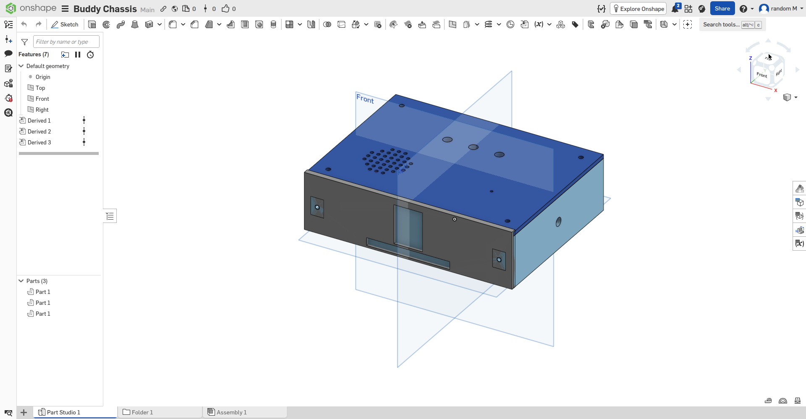
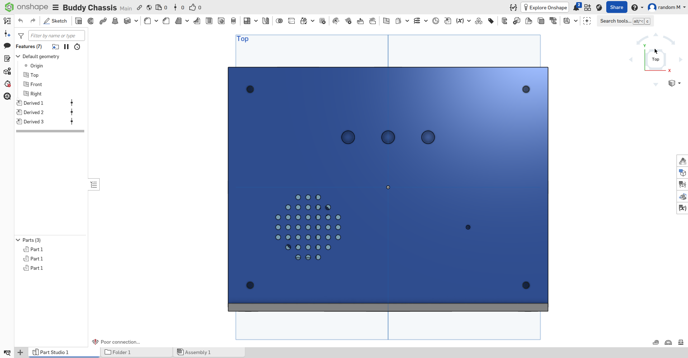
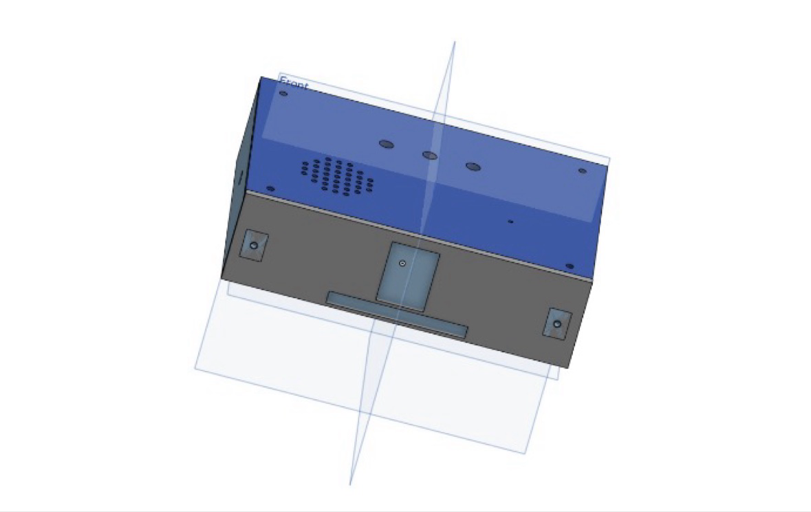
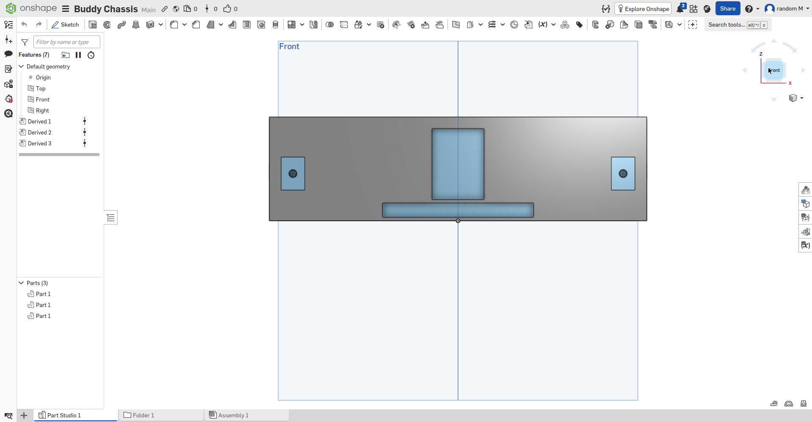
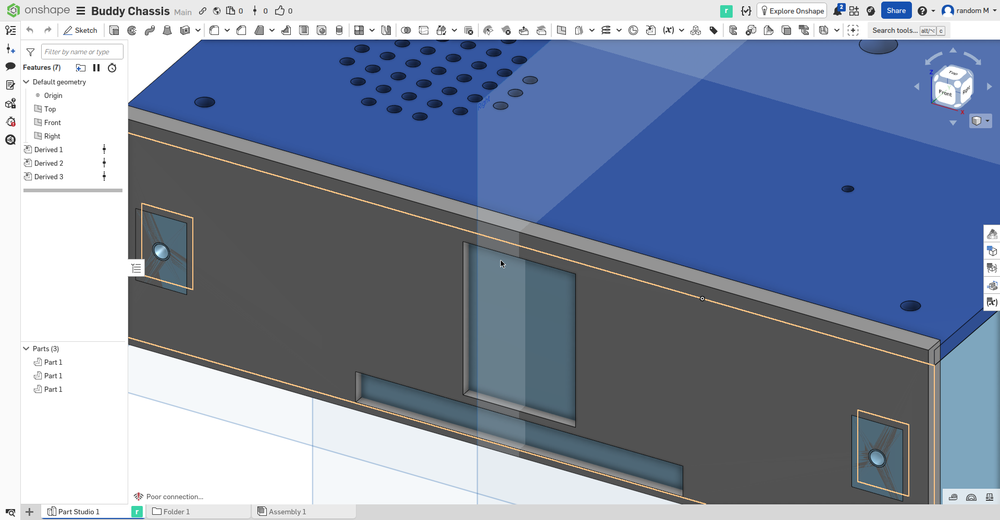

# Buddy Chassis — Week 2 CAD

The 3D-printed chassis for the Buddy robot. Half Life Week 2 (CAD week) project.

Three printed parts, designed to fit the Week 1 electronics plus the parts planned for later weeks (TT motors, speaker, audio amp, mic, USB power bank, M3 hardware).

## The three parts

**Base tub** (160 x 122 x 40 mm) — the main body. Holds the ESP32 on 4x M3 standoffs, 2x TT motor plinths with shaft holes through the side walls, USB power-bank bay, rocker-switch slot and USB-C opening in the rear wall, wire channels, and 4x full-height corner pillars for the lid screws.

**Face frame** (160 x 10 x 44 mm) — the front face. Display window cutout for the 1.47" TFT, RGB light-pipe slot, 4x display mount posts, 2x M3 mounting holes to the base front wall. Stands 4 mm proud of the base at the front as a display bezel.

**Top shell** (160 x 120 x 11 mm) — the lid. 3x tact-button holes, speaker grille (hole array) over a 40 mm speaker pocket with air cavity, mount posts for the MAX98357A amp and INMP441 mic, 4x corner screw holes, alignment lip.

## CAD images

All screenshots are from the Buddy Chassis Onshape document, where the three parts were imported as Derived features.

**onshape-1-assembly-iso.png** — Isometric view of the full assembly. Blue top shell on top, dark gray base below. The front face shows the display window, the RGB light slot beneath it, and the motor shaft holes on the side pads. The speaker grille is visible on the top shell. The feature tree on the left shows the three Derived parts.

**onshape-2-base-top.png** — Top-down view of the top shell. Circular speaker grille (hole array) toward the lower left, three tact-button holes in a row near the top, four corner screw holes, and the mic pinhole.

**onshape-3-angled.png** — Angled close view of the front (Sripad's own screenshot, cropped). Display window and RGB slot on the face frame, motor-mount pads with shaft holes on the sides, blue top shell with the speaker grille.

**onshape-4-faceframe-front.png** — Straight-on front view of the face frame. Display window centered, RGB slot below it, motor-mount pads with shaft holes on the left and right.

**onshape-5-topshell-top.png** — Top-down view of the top shell, same angle as onshape-2. Speaker grille, three button holes, four corner screw holes, mic pinhole.

**onshape-6-grille-closeup.png** — Close-up angled view of the front-left corner. The speaker grille dot pattern on the blue top shell next to the face frame edge, with a motor shaft-hole pad visible on the side. The orange highlight is the selected frame edge.

## Geometry previews

Preview renders generated from the exported STL geometry (no Onshape UI):

- **images/renders/view-1-assembly-iso.png** — assembly, isometric
- **images/renders/view-2-base-top.png** — base tub, top view
- **images/renders/view-3-base-iso.png** — base tub, isometric
- **images/renders/view-4-faceframe-front.png** — face frame, front view
- **images/renders/view-5-topshell-top.png** — top shell, top view

## Exports

- **step/** — `buddy-base.step`, `buddy-face-frame.step`, `buddy-top-shell.step`. CAD exchange format, all validated as closed solids.
- **stl/** — `buddy-base.stl`, `buddy-face-frame.stl`, `buddy-top-shell.stl`. Print-ready meshes. Suggested print: 0.2 mm layers, 3 walls, 20% infill (40% on the motor plinths), face frame printed face-down.

## Bill of materials (Week 2, Tier 1 — $30 cap)

| # | Part | Price | Purpose |
|---|------|-------|---------|
| 1 | HALJIA 2x TT DC gear motors + wheels (3V-6V) | $7.99 | Verifies the 2x motor mounts modeled into the base |
| 2 | 3D printing service — 3 parts, PLA, ~200-300 g | ~$15-25 | Produces the physical chassis (no printer on hand) |

M3 screws/standoffs stay in the Week 5 keyboard BOM as planned. See `docs/week2-bom-draft.md` for the full math.

## Reels

- **reels/buddy-chassis-reel-week2.mp4** — the Week 2 idea reel (posted to Half Life).
- **reels/buddy-progress-reel-v2.mp4** — the Week 2 progress reel (built, not submitted).

## Docs

- **docs/buddy-chassis-final-design.md** — full design notes, schematic cross-check, nominal dimensions.
- **docs/journal-draft.md** — working draft of the Half Life journal entry (do not publish as-is).
- **docs/week2-bom-draft.md** — BOM math and vendor notes.

## Honest status

Every fit-critical dimension is still nominal (vendors list no physical sizes for the ESP32 clone, display module, or TT motors). Nothing gets printed until the real parts are measured against the design. No physical fit has been verified yet.
